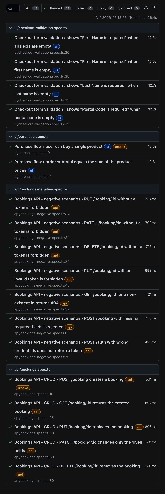

# Playwright + TypeScript Test Automation Framework

[](https://github.com/TomaszNiemasz/playwright-ts-automation-framework/actions/workflows/playwright.yml)

UI and API test automation framework built with Playwright and TypeScript.

- **UI tests** for the [SauceDemo](https://www.saucedemo.com) e-commerce demo (Page Object Model, fixtures)
- **API tests** for [Restful-Booker](https://restful-booker.herokuapp.com) (typed client, Zod schema validation)
- **CI** on GitHub Actions: type check, lint, format check, tests on every push

## Getting started

Requirements: Node.js 20.19+ (or 22.13+ / 24+).

```bash
npm ci
npx playwright install chromium
cp .env.example .env   # optional: defaults already point to the public demo apps
npm test
```

## Useful commands

| Command              | What it does                                   |
| -------------------- | ---------------------------------------------- |
| `npm test`           | Run all UI and API tests                       |
| `npm run test:ui`    | Run only UI tests                              |
| `npm run test:api`   | Run only API tests                             |
| `npm run test:smoke` | Run the fast critical-path tests (`@smoke`)    |
| `npm run test:headed`| Run UI tests with a visible browser            |
| `npm run report`     | Open the last HTML report                      |
| `npm run typecheck`  | Check TypeScript types                         |
| `npm run lint`       | Run ESLint                                     |
| `npm run format`     | Format code with Prettier                      |

## Project structure

```text
config/        Central environment config (URLs, credentials via .env)
clients/       API client (no assertions, cleans up created data)
fixtures/      Playwright fixtures for UI pages and API client
pages/         Page Object Model classes (SauceDemo)
schemas/       Zod schemas for API responses
test-data/     Test data builders
utils/         Shared helpers (assertions, money)
tests/ui/      UI tests
tests/api/     API tests
```

## Test report

